import Callout from '../../components/blog/Callout.astro'
import Diagram from '../../components/blog/Diagram.astro'
import Timeline from '../../components/blog/Timeline.astro'
import TimelineItem from '../../components/blog/TimelineItem.astro'
import Comparison from '../../components/blog/Comparison.astro'

2026 年 11 月，Looped Transformer（通过反复执行共享层来增加有效深度的架构）在开源社区接连交出三份代表性结果。

11 月 20 日，Thinking Machines Lab 开源了 [Inkling 2 Mini](https://thinkingmachines.ai/news/inkling-2-mini/)：总参数 26.4B，中间 12 层共享权重循环执行 3 次，在 Artificial Analysis Intelligence Index 上拿到 20.1 分，排到 100B 以下开源模型的前列。几乎同一时间，NVIDIA 发布了 [Dory1.0-4B](https://arxiv.org/abs/2611.03998)：同一份 4B 权重，只把推理时的循环次数从 1 次调到 4 次，SWE-bench Verified 就从 50.3 升到 61.8（+11.5 分），代理任务的输出 token 数反而减少到原来的 1/2.5 至 1/1.3。在视觉生成侧，9 月底发表的 [Looped-DiT](https://arxiv.org/abs/2609.40305) 让一个 260M 参数的文生图模型在多项基准上超过 6.5 倍参数量的非循环基线，推理计算量还低了 4.9 倍。

但同一套架构放到工程现场，三类角色的体感完全不同。算法和小模型团队拿到的是明确增益：权重体积压缩进了消费级笔记本和单卡的显存边界，推理深度可以沿着循环次数往上推。训练、推理和 RL Infra 团队看到的却是另一组数字：Inkling 2 Mini 只存了 24 层权重（约 19.5 GB），推理引擎却要维护 48 层 KV Cache 和 48 份短卷积状态，在 131k 上下文下的社区实测显存占到 31.2 GiB，高于 27B 混合架构的 Qwen3.8-27B（20.9 GiB）；训练和 RL 阶段还要面对跨轮反向传播的显存膨胀、流水线并行（PP）切分困难，以及动态循环带来的数据并行（DP）同步等待。与此同时，公开的 100B+ 大基模大多按兵不动。2026 年 11 月发表的 [Looped CED](https://arxiv.org/abs/2611.13378) 很能说明现状：它在 552B 参数的 DeepSeek-V4.1-Flash 上算清了 8 轮循环的显存与吞吐，但从头预训练的质量验证只跑到 340M 非嵌入参数。

这三重分化直接来自硬件约束和缩放规律。把 Looped Transformer 放回 2018 到 2026 年的演进脉络里，逐一拆开它的机制、能力边界、系统开销以及 100B+ 规模上的未解问题，比单看某一张榜单更有参考价值。

<Callout type="info" title="阅读前提与数据口径">
本文假定读者熟悉标准 Transformer 的自注意力、KV Cache、混合专家（MoE）以及大模型的基本训练与推理流程。文中区分**论文与官方模型卡报告的数据**、**第三方评测与社区实测数据**以及**本文的机制整理**。尚未在 100B+ 规模上公开验证的问题会如实留作待定。
</Callout>

## 循环深度在 Scaling 里的位置：MoE 的反面

过去几年，大语言模型对参数和计算的分配主要沿着两条路径展开。稠密缩放同时拉大参数量 $$N$$ 和单 token 计算量 $$C$$，知识容量与计算深度绑定增长。稀疏混合专家（MoE）通过路由大幅扩充总参数 $$N$$，同时压低单 token 激活参数和 FLOPs，用更大的静态权重空间换取更高的知识容量和吞吐效率。

Looped Transformer（文献中也称 Recurrent Depth）走的刚好是 MoE 的反方向：固定唯一参数量 $$N$$，把同一组 Transformer 层重复执行 $$R$$ 次，换取更大的有效网络深度和单 token 计算量 $$C$$。把显式思维链（Chain-of-Thought, CoT）也放进同一张表，四种计算扩展方式的资源取舍很清楚：

| 扩展路径 | 参数存储 $$N$$ | 单 token 计算量 $$C$$ | KV Cache 增长方式 | 主要放大的能力 | 核心工程瓶颈 |
|---|---|---|---|---|---|
| 稠密缩放（Dense） | 随规模线性增大 | 随规模线性增大 | 随物理层数线性增长 | 知识容量与计算深度同步提升 | 显存带宽与训练总算力双重受限 |
| 稀疏 MoE | 大幅扩大（多专家） | 保持低激活比例 | 仅取决于物理注意力层数 | 知识容量、领域特化、吞吐效率 | 全量权重显存、All-to-All 通信与负载均衡 |
| 显式 CoT | 固定 | 单 token 固定，靠序列长度 $$L$$ 拉长总算力 | 随生成的思考 token 数线性增长 | 可验证、可审计的多步符号推理 | 解码串行延迟高、长输出显存占用大 |
| Looped-MoE（循环深度） | 固定（权重复用） | 按循环次数 $$R$$ 放大 | 默认按有效层数 $$R$$ 倍增长（除非跨轮共享） | 紧凑权重下的多跳推理、状态追踪与隐式计算 | 跨轮 KV 膨胀、串行解码延迟、循环稳定性与 PP/RL 调度 |

循环深度省下来的只是静态参数存储，也就是磁盘和显存里的权重体积。前向计算 FLOPs 并没有少，默认设计下每次循环产生的 KV Cache 和权重访存次数也同样要照单支付。

它和显式 CoT 也不是替代关系。CoT 把计算沿着时间轴摊开，每一步把中间状态投影回离散词表里的一个 token。循环深度则把计算沿着深度轴叠加，在输出同一个 token 之前，用连续隐状态完成多轮迭代。两种机制可以叠加，Inkling 2 Mini 和 Dory1.0-4B 实际都在同时使用潜空间循环和显式推理链。

## 从 2018 年停滞到 2026 年重开：两次工程解锁

Looped Transformer 早在 2018 年就已提出，沉寂近七年后，靠稀疏路由和可控跨轮状态机制两项工程改造才重新进入主线视野。

<Timeline>
  <TimelineItem date="2018-07" label="Universal Transformer">
    Dehghani 等人在 <a href="https://arxiv.org/abs/1807.03819">arXiv:1807.03819</a> 提出并行时间、循环深度的 Transformer，结合自适应停止（ACT）在算法泛化与翻译任务上验证了潜力，但在随后的大模型稠密缩放阶段长期停滞。
  </TimelineItem>
  <TimelineItem date="2025-02" label="Huginn-3.5B">
    Geiping 等人在 <a href="https://arxiv.org/abs/2502.05171">arXiv:2502.05171</a> 将循环深度做到 3.5B 参数与 800B tokens，确立了 Prelude-Recurrent Core-Coda 的三段式结构，证明测试时展开隐空间迭代可以拉升推理基准。
  </TimelineItem>
  <TimelineItem date="2025-07" label="Mixture-of-Recursions">
    Bae 等人在 <a href="https://arxiv.org/abs/2507.10524">arXiv:2507.10524</a> 提出 MoR，将权重共享与 token 级动态递归路由结合，在 135M 到 1.7B 规模上验证选择性 KV 缓存与首轮 KV 复用。
  </TimelineItem>
  <TimelineItem date="2025-10" label="Ouro / LoopLM">
    ByteDance Seed 团队在 <a href="https://arxiv.org/abs/2510.25741">arXiv:2510.25741</a> 将 1.4B 与 2.6B 循环模型扩展至 7.7T tokens，并首次通过受控实验确认循环提升的是<strong>知识操作能力</strong>，而非<strong>知识存储容量</strong>。
  </TimelineItem>
  <TimelineItem date="2026-05~10" label="Looped-MoE 与稳定化配方">
    <a href="https://arxiv.org/abs/2605.09165">Sparse Layers Critical</a>、<a href="https://arxiv.org/abs/2606.04438">LoopMoE</a>、<a href="https://arxiv.org/abs/2607.16051">Loopie</a>、<a href="https://arxiv.org/abs/2609.35751">Foil</a>、<a href="https://arxiv.org/abs/2610.01153">LOOM</a> 与 Meta 的 <a href="https://arxiv.org/abs/2610.40325">How to Loop Your Transformer</a> 接连定位了稠密循环失效的原因，补齐了稀疏路由与跨轮稳定化设计。
  </TimelineItem>
  <TimelineItem date="2026-11" label="工程落地与系统补课" active>
    <a href="https://arxiv.org/abs/2611.03998">Dory1.0-4B</a>、<a href="https://arxiv.org/abs/2611.05234">ARLoop</a> 与 <a href="https://thinkingmachines.ai/news/inkling-2-mini/">Inkling 2 Mini</a> 将循环模型推向代码和代理基准；同月 <a href="https://arxiv.org/abs/2611.13378">Looped CED</a>、<a href="https://arxiv.org/abs/2611.19649">LoopFill</a>、<a href="https://arxiv.org/abs/2611.24301">LoopCache</a>、<a href="https://arxiv.org/abs/2611.24576">Late Entry</a> 集中处理 KV 膨胀与串行解码瓶颈。
  </TimelineItem>
</Timeline>

### 为什么 Universal Transformer 沉寂了七年

2018 年的 [Universal Transformer](https://arxiv.org/abs/1807.03819) 在特定假设下具备图灵完备性，在字符串复制和逻辑推断等外推任务上也赢过标准 Transformer。但此后七年的大语言模型训练里，工业界几乎全部选择了更深、更宽的非共享层叠结构。结合 2025 到 2026 年的多篇诊断论文，当年循环路线跑不起来，主要卡在三个问题：

1. **深度诅咒与方差漂移**：标准残差连接把每一轮输出直接累加到同一条隐状态流上。共享层反复迭代时，残差方差逐轮放大，深层循环很快出现表示漂移和训练不稳。[LOOM](https://arxiv.org/abs/2610.01153) 以及 Meta 的 [How to Loop Your Transformer](https://arxiv.org/abs/2610.40325)（实验做到 1B 参数、155B tokens、32 轮循环）都记录了同一现象：增加循环次数并不单调有效，收益很快饱和，甚至反转。
2. **稠密共享的功能冲突**：在标准 Transformer 里，浅层偏词法与局部语法，中层做语义整合与关系推理，深层把表示映射到输出词表。强迫同一套稠密权重在每一轮里兼顾这三种角色，会让表达能力早早撞顶。早期未改造的开源稠密循环大多被迫停在 2 轮，超过 2 轮后额外 FLOPs 换不回对等收益。
3. **等算力下打不过直接加参数**：如果手里有 $$N$$ 倍的预训练算力，是把一个小模型循环 $$N$$ 次，还是把非循环模型的参数量直接扩大到 $$N$$ 倍？在稠密架构下，过去很长一段时间答案都是后者。[Loopie](https://arxiv.org/abs/2607.16051) 和 [Lee et al.](https://arxiv.org/abs/2605.09165) 都明确把这一点列为循环架构长期停留在边缘的主要原因。

### 稀疏路由打破权重共享的对称性

2026 年扭转缩放曲线的第一个改动，是把循环从稠密骨干换成了 MoE 骨干。

2026 年 5 月发布、11 月修订的 [Sparse Layers are Critical to Scaling Looped Language Models](https://arxiv.org/abs/2605.09165) 做了一组四路对照，同时比较稠密和 MoE 模型在循环与非循环下的缩放表现。结论很明确：稠密循环模型的缩放斜率确实不如标准基线，但 Looped-MoE 反而超过标准基线。根源在于跨轮路由分化（Routing Divergence）。物理层权重虽然共享，但路由器在第 1 轮、第 2 轮和第 3 轮面对的是不断演进的隐状态，每次经过同一物理层时可以激活不同的专家子集。模型相当于用同一个专家池，在推理路径上动态组合出不同的有效计算图，既保住了紧凑的权重体积，又绕开了稠密共享的对称性冲突。

2026 年下半年的四篇独立工作把这套机制推得更细。[LoopMoE](https://arxiv.org/abs/2606.04438) 首次在总参数、单 token FLOPs 和注意力/FFN 激活比例完全对齐的条件下对比 Looped-MoE 与 Vanilla MoE，通过同时依赖迭代轮次和隐状态的 `IterAdaLN` 调制打破对称性，相对同预算基线的平均优势从 3B 规模的超过 1 分扩大到 9B 规模的约 3 分。[Loopie](https://arxiv.org/abs/2607.16051) 开源了 20B-A2B 与 6B-A0.6B 两个循环 MoE，在等预训练算力消融中跑赢了标准 30B-A3B 非循环基线。[Foil: How to Loop MoE](https://arxiv.org/abs/2609.35751) 则在固定专家参数和专家计算量的前提下，给出「压扁专家层、解绑注意力」的做法，把专家层数减半，每层专家数和循环轮数各加倍，同时让每轮各自保留独立注意力参数，在 100B token 训练下把预训练 loss 压低了 0.012 nat。紧接着，[LOOM](https://arxiv.org/abs/2610.01153) 指出 Looped-MoE 超过 2 轮后容易出现专家选择坍缩，即路由器反复选中同一批专家导致后续轮次空转；通过为每轮配独立路由器、缩放残差更新、每轮重新注入输入嵌入并加入跨轮 EMA 残差，LOOM 在 100M 到 1.7B 规模上把稳定循环推进到了 9 到 12 轮，700M 模型在近等 FLOP 下 5 轮最优（困惑度从 18.36 降至 16.54），1.7B 模型 9 轮困惑度从 9.62 降至 7.77。

### 用门控和块级注意力稳住跨轮状态

有了 MoE 路由之后，跨轮信息怎么传、循环放在网络的哪一段，依然决定模型能不能稳定训到万亿 token。2026 年 11 月的三套代表系统，[Inkling 2 Mini](https://thinkingmachines.ai/news/inkling-2-mini/)、[Dory1.0-4B](https://arxiv.org/abs/2611.03998) 和 [ARLoop](https://arxiv.org/abs/2611.05234)，都收敛到了三段式结构（Prelude-Core-Coda）加显式跨轮状态通路。

以工程细节公开最全的 Inkling 2 Mini 为例，结合其 [Model Card](https://thinkingmachines.ai/model-card/inkling-2-mini)、[官方发布说明](https://thinkingmachines.ai/news/inkling-2-mini/) 和 [vLLM 工程博客](https://vllm.ai/blog/2026-11-20-inkling2-mini)，核心设计落在两处：

1. **只循环中间层**：物理上共 24 层，分成 4 个 6 层块。Block 1（Prelude，第 0 到 5 层）跑 1 次，Block 2 和 Block 3（Core，第 6 到 17 层）共享权重循环 3 次，Block 4（Coda，第 18 到 23 层）跑 1 次，总计 48 次层访问。Thinking Machines 的消融显示，循环中间 12 层在 28 项评测中有 27 项胜过循环最后 12 层。这和 Meta [How to Loop Your Transformer](https://arxiv.org/abs/2610.40325) 的结论一致：严格固定参数上限时循环全模型质量最高，但在训练 FLOPs 受限时，只循环中间块回报更高，因为入口词法编码和出口词表投影不需要反复重写。
2. **带门控的一阶马尔可夫消息传递**：第 2 轮和第 3 轮并没有把上一轮末层输出直接覆盖回 Core 入口，而是每轮都以 Prelude 输出为基准，用 Kimi 提出的 [Attention Residuals](https://arxiv.org/abs/2603.15031)（块级深度注意力；[ARLoop](https://arxiv.org/abs/2611.05234) 也独立验证了滑动窗口深度注意力对循环模型的增益）读取上一轮 Block 2 和 Block 3 的块级状态 $$m$$，再经由秩为 64 的门控控制器融进每个子层输入。注意力的 Q、K、V 和 MLP 输入各自读取独立消息，因此从第 2 轮起，每轮每个 token 要做 48 次消息读取：

```math
\begin{aligned}
h &= W_{\text{down}} \cdot \left[\operatorname{RMSNorm}(x),\, \operatorname{RMSNorm}(m)\right] \\
y &= \left(1 - \tanh(W_{\text{forget}} h)\right) \odot x + \tanh(W_{\text{gain}} h) \odot m
\end{aligned}
```

这个门控在训练初期初始化为关闭状态，让模型从接近非循环 Transformer 的安全区起步，再逐步打开跨轮通路。NVIDIA 的 Dory1.0-4B 走了另一条稳定化路线：它在归一化 Transformer（nGPT）骨干上分成 8 层输入块、20 层共享循环块和 8 层输出块，每次进入循环块前将原始输入隐状态加回并做 L2 归一化，用球面约束直接限制方差漂移。

```mermaid
graph LR
    subgraph prelude["Block 1: Prelude (1x)"]
        P["Layers 0-5<br/>入口表示"]
    end

    subgraph loop1["Core Pass 1"]
        L1B2["Block 2 (L6-11)"]
        L1B3["Block 3 (L12-17)"]
        L1B2 --> L1B3
    end

    subgraph loop2["Core Pass 2 (共享权重)"]
        G2["Block AttnRes<br/>+ rank-64 门控"]
        L2B2["Block 2 (L6-11)"]
        L2B3["Block 3 (L12-17)"]
        G2 --> L2B2 --> L2B3
    end

    subgraph loop3["Core Pass 3 (共享权重)"]
        G3["Block AttnRes<br/>+ rank-64 门控"]
        L3B2["Block 2 (L6-11)"]
        L3B3["Block 3 (L12-17)"]
        G3 --> L3B2 --> L3B3
    end

    subgraph coda["Block 4: Coda (1x)"]
        C["Layers 18-23<br/>输出投影"]
    end

    P --> L1B2
    P -.->|"保留 Prelude 基线"| G2
    P -.->|"保留 Prelude 基线"| G3
    L1B2 -.->|"跨轮状态 m"| G2
    L1B3 -.->|"跨轮状态 m"| G2
    L2B2 -.->|"跨轮状态 m"| G3
    L2B3 -.->|"跨轮状态 m"| G3
    L3B3 --> C

    style P fill:#d3f9d8,stroke:#2f9e44,stroke-width:2px
    style L1B2 fill:#e5dbff,stroke:#5f3dc4,stroke-width:2px
    style L1B3 fill:#e5dbff,stroke:#5f3dc4,stroke-width:2px
    style G2 fill:#ffe8cc,stroke:#d9480f,stroke-width:2px
    style G3 fill:#ffe8cc,stroke:#d9480f,stroke-width:2px
    style L2B2 fill:#e5dbff,stroke:#5f3dc4,stroke-width:2px
    style L2B3 fill:#e5dbff,stroke:#5f3dc4,stroke-width:2px
    style L3B2 fill:#e5dbff,stroke:#5f3dc4,stroke-width:2px
    style L3B3 fill:#e5dbff,stroke:#5f3dc4,stroke-width:2px
    style C fill:#c5f6fa,stroke:#0c8599,stroke-width:2px
```

<Diagram title="INKLING 2 MINI 跨轮状态流" caption="24 层物理权重分为 4 个 6 层块，中间 12 层循环 3 轮共 48 次层访问，第 2、3 轮通过 Block AttnRes 与 rank-64 门控读取上一轮块级状态">

</Diagram>

可解释性团队 [Goodfire](https://www.goodfire.com/research/interpreting-inkling-2-mini/) 对 Inkling 2 Mini 的早期白盒分析印证了跨轮通路的实际作用。在 2,304 维隐状态里，像坐标 $$d_{2027}$$ 这样的异常维度会在第 1 轮和第 2 轮末层附近大幅拉高，专门给下一轮 Block 3 的跨轮读取器传递路由信号；到了第 3 轮末尾、后面不再有新循环时，这一维度的激活会被抹平。模型学出的是一套跨轮内部通信机制，而不只是重复执行同一段计算。

## 循环真正放大的是什么：能力边界与模态分化

2025 到 2026 年的评测数据已经把 Looped Transformer 的能力边界划得很清楚。

### 知识容量不动，知识操作才涨

三家独立团队的受控实验给出了高度一致的证据。

ByteDance Seed 的 [Ouro](https://arxiv.org/abs/2510.25741) 把 1.4B 和 2.6B 循环模型训到 7.7T tokens，多项基准接近 12B 级模型，但合成探针实验证实，循环并没有提高单位参数记住新事实的能力，收益全部来自更强的知识操作（Knowledge Manipulation），即对已有知识做多步组合、检索和推导。

NVIDIA 的 [Dory1.0-4B](https://arxiv.org/abs/2611.03998) 用同一份 4B 权重把推理循环从 1 调到 2 再到 4，SWE-bench Verified 从 50.3 跳到 59.5 再到 61.8（+11.5 分），SciCode 从 27.3 升到 34.9 再到 35.1。在代理任务上，4 轮循环的平均输出 token 数只有 1 轮循环的 0.40× 到 0.80×，其中 GDPval-AA-V2 降到 0.40×，Terminal-Bench 2.1 降到 0.50×，原本靠长输出试错的步骤被转移进了隐空间。但按模型评测汇总，闭卷事实问答基准 AA-Omniscience 从 1 轮到 4 轮一直停在 10.0，没有变化。

Thinking Machines 的 Inkling 2 Mini 及配套变长循环研究权重 `TML-d24-varloop-research`（[官方说明](https://thinkingmachines.ai/news/inkling-2-mini/)）呈现出同样的分布。在无 CoT 的 [Think Fast](https://arxiv.org/abs/2606.07157) 基准上，时间跨度从 1 轮的 16 秒升到 3 轮的 37 秒；在纯串行多跳追踪任务 N-Hop Lookup 上，加到 10 轮仍在涨分；标准评测里涨幅最大的也是长上下文检索（MRCR v2、GraphWalks BFS）、数学科学推理和长程代码代理（DeepSWE v1.1 48.2%，SWE-bench Pro v2 Hard 77.9%，SWE-bench Verified 79.2%）。反过来，闭卷事实题（AA-Omniscience、SimpleQA Verified、WorldVQA）对循环次数几乎不敏感，多轮对话（MultiChallenge 50.0%）和复杂指令约束（ComplexConstraints v1.1 33.4%）也仍落后于 Qwen3.8-27B。

选型边界因此很直白：循环深度放大的是串行推理、代码修改和长上下文状态追踪，不是事实记忆容量。重事实查询依然要靠外挂检索和工具调用补齐。

### 为什么文生图收益干净，开放域 LLM 却受限于数据和深度饱和

把跨模态结果放在一起看，循环架构在文生图（T2I）里的消融收益比开放域语言模型干净得多。

[Looped-DiT](https://arxiv.org/abs/2609.40305) 给出了具体机制。作者先说明，扩散 Transformer 里直接套朴素循环同样会退化，因为中间循环缺少有效监督，不受约束的自注意力会在反复迭代中磨掉局部纹理。加入中间循环深度监督（deep supervision）和自调制注意力（self-modulating attention）后，一个 260M 的 Looped-DiT 在多项文生图基准上超过 6.5 倍参数量的非循环模型，推理计算量低 4.9 倍。固定推理预算下，在单步去噪内增加循环深度甚至比增加去噪步数收益更大，能逐轮修正早期画面的布局和细节错误。需要附带说明的是，社区审读指出 Looped-DiT 与部分外部基线的总训练时长并不相同，跨论文对比仍要对齐训练预算。但即便只看论文内部严格对齐参数和算力的消融，T2I 依然比开放域 LLM 更容易出清晰收益，原因有两条：

1. **中间监督目标明确**：文生图的每一轮循环都对齐同一个清晰图像目标（或去噪速度场），每一轮的局部偏差可以直接定义和纠正。自回归语言模型里，绝大多数 token 只是平滑的语法衔接，真正需要多步隐式规划的高难决策点在语料中分布很稀疏。
2. **深度饱和与后训练配方门槛**：无论是 Ouro、Dory、Inkling 的变长循环实验，还是 Meta 跑到 32 轮的缩放研究，常规语言任务的边际收益大多在 3 到 4 轮就迅速收窄。想让更深的循环在后训练里持续起效，高度依赖无冗余、长程且推理长度与正确率正相关的数据与课程设计。Dory1.0-4B 在 RLVR 阶段专门设计了按难度分配循环次数的课程；Inkling 2 Mini 则是先用 384 专家（top-8）启动训练，在 mid-training 剪枝掉三分之二缩成 128 专家，再靠更大的内部 Inkling 模型蒸馏 1T tokens 恢复能力，之后叠加 2.2T tokens（2,000 步）的 RL 和 on-policy distillation。开放域语言模型想把循环用好，靠的远不只是改几行前向代码。

## Infra 侧的真实代价，以及 11 月的四条系统解法

把视角从准确率曲线切到显存占用、GPU 利用率和端到端延迟，训练、推理和 RL Infra 团队对循环架构的保留态度就很好理解。

### 推理代价：3.4B 纸面激活背后的 5.4B 权重读取与 48 层状态

社区拆解 Inkling 2 Mini 时，最先指出的落差来自规格表和实际硬件工作量：标称 3.4B 激活参数、24 层权重，但硬件每生成一个 token 实际要承担 5.4B 有效激活参数和 48 层状态。

对照 [Inkling 2 Mini Model Card](https://thinkingmachines.ai/model-card/inkling-2-mini) 和 [vLLM 工程博客](https://vllm.ai/blog/2026-11-20-inkling2-mini) 的细节，这笔账可以算得很准。单次走完 24 层激活约 3.4B 参数，中间 12 层每多循环 1 次增加约 1.0B 有效激活参数，因此 3 轮循环的有效激活参数是 5.4B（Artificial Analysis 估算单个文本 token 触达的唯一权重约 3.1B，但总计算按 5.4B 计）。在显存带宽受限的小 batch 自回归解码阶段，只要缺乏跨轮权重常驻优化，硬件每一轮都要重新把循环层权重从显存搬进计算单元。

状态显存的膨胀更直接。模型物理上包含 20 层滑动窗口注意力（窗口 1,024 tokens）和 4 层全局注意力（第 5、11、17、23 层），每层 8 个 KV 头、头维度 128。由于第 11 层和第 17 层落在 3 轮循环的 Core 内部，且每轮各自维护独立的 KV Cache 和短卷积状态，引擎总共要管 48 份 KV Cache 和 48 份卷积状态，全局注意力 KV 层数也从 4 层变成 8 层（第 5 层 1 次、第 11 层 3 次、第 17 层 3 次、第 23 层 1 次）。

在 BF16 精度下，单层单 token 的 KV 占用为 $$2 \times 8 \times 128 \times 2 = 4096$$ 字节。跑满 1M 上下文时，40 次局部滑窗层访问合计只有约 0.17 GB，但 8 层全局 KV 直接占掉：

```math
\text{KV}_{\text{global}}(1\text{M},\,\text{BF16}) = 8 \times 4096\text{ B} \times 10^6 \approx 32.8\text{ GB}
```

哪怕权重经过 NVFP4 与 MXFP8 混合量化压到 19.5 GB，单是 1M 上下文的 BF16 全局 KV 就已经超过一台 32 GB 统一内存笔记本的物理上限。

11 月 20 到 21 日的社区实测很快验证了这些开销。在 131k 上下文下，社区测得 Inkling 2 Mini 显存占用约 31.2 GiB，高于 Qwen3.8-27B 的 20.9 GiB，原因在于 Qwen 用线性注意力配稀疏全局 KV，而 Inkling 的循环层把全局 KV 乘了系数。延迟方面，48 次层访问加上第 2、3 轮每轮 48 次跨轮消息读取与 rank-64 门控计算，把前向切成了大量细碎算子；有开发者在 Apple Silicon MLX 上仅靠减少小 kernel 启动次数，就把解码速度从 47 tok/s 提到 70 tok/s，说明早期本地运行时大量时间耗在调度而不是矩阵乘法上。在 llama.cpp 和 SGLang 的实测中，RTX 4080 16GB、RTX PRO 5000 与 DGX Spark 的单流速度大致落在 34 到 71 tok/s；随模型发布的 3 层 DSpark 投机解码器在结构化代码上能提速约 12%，但在自由文本上因接受率偏低反而减速 28% 到 30%。

至于「循环能不能省输出 token」，实测也给出了两面。Thinking Machines 内部消融显示，在 512k token 代理轨迹上，非循环基线训练算力少 7.5%，但要多花 140% 的推理算力才能追平循环模型的 loss；在 `TML-d24-varloop-research` 的受控对比里，GPQA Diamond 5 轮循环的平均 CoT 长度也从 1 轮的 3,703 tokens 缩到 1,661 tokens。但 Artificial Analysis 在完整榜单上的独立测试显示，Inkling 2 Mini 追平 Qwen3.8-27B（AA Index 20）时，代理计算量（有效激活参数乘以 token 数）确实低了约 2.8 倍，实际输出 token 数却比 Qwen3.8-27B 多了约 38%（约 152k 对 110k）。循环提供了压缩冗余试错的余地，最终端到端耗时尚需把单 token 延迟、KV 带宽和 RL 后的输出风格合并核算。

### 训练与 RL 代价：跨轮反传显存、流水线切分与动态深度气泡

把场景切到大集群预训练和大规模 RL，系统摩擦更难靠局部算子优化绕开：

- **跨轮反向传播的激活显存**：完整穿过 $$R$$ 轮循环反传，激活值显存近似按 $$R$$ 倍放大。[LOOM](https://arxiv.org/abs/2610.01153) 做到 9 到 12 轮循环时，只能按每 3 轮截断分段反传（segmented BPTT），才在 350M 模型上把峰值显存压在 12.6 GiB 附近。放进超大规模预训练时，截断梯度带来的偏差与完整重计算的算力开销之间存在直接取舍。
- **流水线并行（PP）的切分冲突**：标准 1F1B 或交错流水线并行默认层与层构成有向无环图。中间 12 层原地循环 3 次会打破单向切分：把整个循环 Core 塞进同一阶段会限制单阶段参数上限，跨阶段反复回传激活张量又会增加节点间通信和调度气泡。
- **动态深度与 RL Rollout 的同步等待**：如果不同样本或不同 token 走不同循环次数，数据并行组内每个 microbatch 必须同步采样同一深度，否则浅循环的 GPU 只能空等深循环的卡。在 RLVR 和代理 rollout 中，可变循环深度还会拉大长短轨迹的尾延迟方差；而 token 级动态早退通常不得不放弃独立跨轮 KV，或为跳过的深层补算历史 KV，否则后续 token 无法对完整深层上下文做注意力。

### 2026 年 11 月的四条系统解法

系统社区对这些开销的回应速度很快。仅 2026 年 11 月，就有四条针对性明确的解法集中发表：

1. **末轮与不动点 KV 共享**：NVIDIA 在 [Dory1.0-4B](https://arxiv.org/abs/2611.03998) 中验证了只缓存最后一轮循环 KV，无论循环几次显存都停在 1 轮大小，4 轮循环下的精度变动落在 -2.1 到 +0.4 分之间，输出长度几乎不变。[Looped CED](https://arxiv.org/abs/2611.13378) 则基于类似 DeepSeek-V4.1-Flash 的非对称因果编码器-解码器结构，将循环放在生成全局 KV 的编码器侧，并用随机循环深度训练诱导隐状态收敛到不动点，让各轮无损共享末轮全局 KV。它在 1/6 全局 KV 下拿回标准循环 Transformer 86% 到 93% 的质量收益；在单台 4×GB200 节点上模拟 552B DeepSeek-V4.1-Flash 循环 8 轮时，逐层逐轮 KV 连 1 条 128K 请求都放不下，Looped CED 把单 token KV 压小 36.8 倍，并发装下 38 条 128K 请求，8K prompt 吞吐提高 3.6 倍。
2. **波前自投机与循环槽位 KV 调度**：[LoopFill](https://arxiv.org/abs/2611.19649) 把浅轮预测和多 token 后缀草稿合并进同一验证树，将不同循环深度的候选 token 放进同一次前向批处理，在 Ouro-2.6B 和 Huginn-3.5B 上分别拿到 5.85× 和 5.13× 的免训练无损加速。[LoopCache](https://arxiv.org/abs/2611.24301) 针对长上下文下波前投机每步搬运 $$R$$ 份 KV 的带宽瓶颈，改为按单轮周期轮转 KV 槽位并结合置信度动态刷新草稿，相对 WFD 和 LoopSpec 分别取得 10.25× 和 14.56× 的平均加速。
3. **Late Entry 深缓存入口**：传统早退让新 token 跑完浅轮就停，结果把历史 KV 截断在浅层。[Late Entry](https://arxiv.org/abs/2611.24576) 反过来让新 token 跳过前几轮，直接进入最后 $$K < T$$ 轮读取已沉淀的深层上下文 KV，已提交的历史 token 则在后台异步补完 $$1 \to T$$ 轮。在 Ouro-2.6B（$$T=4$$）和 Huginn-3.5B（$$T=64$$）上，它分别实现了 5.2× 和 8.4× 的贪心精确加速。
4. **服务引擎算子融合**：[vLLM](https://vllm.ai/blog/2026-11-20-inkling2-mini) 在 Inkling 2 Mini 发布当天提供的原生支持，核心工作就是把每子层的跨轮消息读取与 FP32 精度下的 rank-64 门控合并成融合算子，在保持参考数值一致的同时压低调度开销。

<Comparison
  leftLabel="优化后改变的物理量"
  rightLabel="朴素循环的原生开销"
  left={{
    title: "把额外成本从显存与串行路径里压出去",
    items: [
      "KV 显存与循环次数解耦：靠末轮缓存或编码器不动点，把多轮 KV 压回接近 1 轮",
      "串行深度转为批内并行：靠浅轮自投机和周期 KV 轮转，一次前向同时推进多步",
      "关键路径跳过浅轮：靠 Late Entry 复用深层历史缓存，把完整 1 到 T 轮补算移到后台",
      "算子粒度重新合并：在引擎层把零碎的消息读写与门控计算合进更少的 kernel"
    ]
  }}
  right={{
    title: "直接部署循环架构时绕不开的开销",
    items: [
      "每轮各自持有 KV 与卷积状态，长上下文显存按有效深度成倍增长",
      "小 batch 解码每轮重读共享权重，带宽开销按有效激活参数而非纸面参数算",
      "跨轮反传放大激活显存，共享中间层破坏标准流水线并行的无环切分",
      "可变循环深度放大 DP 同步等待与 RL 轨迹的尾延迟方差"
    ]
  }}
/>

## 为什么 100B+ 大基模依然克制，以及 CoT 可监控性的隐忧

小模型已经跑出结果，系统侧也在密集补课，但截至 2026 年 11 月，公开世界里依然看不到一个从头预训练并完成质量验证的 100B 到 1T 级循环基础模型。

### 340M 质量验证与 552B 显存测算之间的断层

把 2026 年公开的循环语言模型按规模排开，断层很明显。拥有完整开源权重与质量评测的型号集中在 1.2B 到 26B 区间，包括 ARLoop 1.2B、Ouro 2.6B、Huginn 3.5B、Dory1.0-4B、LoopMoE 9B、Loopie 20B-A2B 和 Inkling 2 Mini 26.4B。学术缩放配方则停在更小规模：Meta 的 32 轮研究止于 1B，LOOM 止于 1.7B，Looped CED 在 552B DeepSeek-V4.1-Flash 上测出了漂亮的服务吞吐，但预训练质量曲线只跑到 340M 非嵌入参数。

这个断层背后有四个尚未在 100B+ 规模上打通的约束：

1. **主导瓶颈不同**：在 4B 到 30B 区间，静态权重显存是卡死能否加载的第一门槛，20 GB 装得下 26B 模型，装不下 70B 模型，用额外算力换小体积很划算。到了 200B 到 1T 的云端大基模区间，模型本来就要跨多卡多机部署，决定成本的是单节点并发吞吐、长上下文 KV 容量和整集群有效训练利用率。在这个区间，继续加宽稀疏 MoE 专家并压缩注意力 KV，能顺畅吃满现有 PP/EP 基础设施，引入循环带来的流水线重构风险代价更高。
2. **超大算力下的 iso-FLOP 胜率缺少公开实证**：LoopMoE、Loopie、LOOM 和 Inkling 的小规模消融在 100M 到 20B 区间证明了循环的效率。但把预训练预算推到数十万亿 token 和千卡级集群时，把额外 FLOPs 投给 3 到 4 轮循环，是否依然优于投给更宽的稀疏 MoE、更强的 mid-training 退火数据和更长周期的 RL，目前公开文献还没有 100B+ 级别的正面对照。
3. **低比特量化误差累积**：同一套权重在循环路径上反复参与计算，会放大低比特量化误差。原生 NVFP4 起步的 Inkling 2 Mini 也不得不把最后 4 层留在 MXFP8，并在跨轮门控里维持 FP32 精度。社区量化维护者同样观察到，低比特量化循环 MoE 的精度保持比普通 MoE 更脆弱。
4. **缺少更大的教师模型**：Inkling 2 Mini 在 26B 体积上拿到 100B 以下的前排成绩，依赖一套包含大模型蒸馏的训练流程，即先训 384 专家、mid-training 剪枝到 128 专家，再从更大的内部 Inkling 模型蒸馏 1T tokens 恢复能力。小模型可以站在 600B 级大模型的肩膀上做剪枝蒸馏，但 500B 到 1T 级的旗舰基模头顶上没有更大的教师，必须自己从头收敛。

### 26B 上成立的 CoT 可监控性未必能外推

算力和系统之外，Inkling 2 Mini 在 2026 年 11 月还把一个对齐与安全问题推到了台前：当更多推理步骤被压进循环的隐空间里，可见的文本思维链还能反映模型真实的决策过程吗？

Thinking Machines 对这个问题采取了公开测试的态度，同步释放了 `TML-d24-varloop-research` 变长循环权重，配合 [NDIF](https://ndif.us/) 提供零算力门槛的白盒激活读写接口，并联合 [Goodfire](https://www.goodfire.com/research/interpreting-inkling-2-mini/) 做机制可解释性研究。26B 规模上测到的结果呈两面性。一方面，循环明显抬高了不写文字时的静默推理能力，Think Fast 无 CoT 时间跨度从 1 轮的 16 秒升到 3 轮的 37 秒；在 GPQA Diamond 全部 5 种轮次都答对的题目里，5 轮循环的平均 CoT 长度从 3,703 tokens 缩减到 1,661 tokens。另一方面，在 26B 规模下，变短后的 CoT 依然保持可读性，句长与英语词典词比例没有下降，缩短主要来自思路更直接、回溯减少；在 LinuxArena 代理控制评测与 CoT 监控测试中，也没有看到明显的可监控性下降。

Thinking Machines 在发布说明里留了一句很克制的限定：这个结论在当前规模上成立，但随着规模扩大未必继续成立。这也是不少人欢迎开源 26B 循环小模型，却对闭源千亿级前沿模型采用深度循环保持警惕的直接原因。一旦更大规模的循环模型把多跳规划大比例移入不可见的潜空间，只靠审计文本 CoT 的监控能力就会变弱，而白盒激活监测工具目前还远没到生产可用的程度。

## 2026 年底的真实坐标

把八年演进和 2026 年 11 月的一批模型、论文放在一起看，Looped Transformer 的位置可以归结为四点。

第一，它在 4B 到 30B 的参数受限区间和文生图领域已经跑通了工程路径。MoE 路由分化打破了稠密共享的对称性，Prelude-Core-Coda 与门控跨轮状态稳住了万亿 token 级训练，让循环深度不再停留在算法泛化玩具阶段。

第二，它的能力增益是不对称的。循环放大的是单位参数下的串行推理、多跳检索与代码代理深度，闭卷事实容量基本不随循环次数增加。

第三，省下来的静态权重空间，会在系统侧变成 KV、带宽和调度开销。架构设计必须和末轮/不动点 KV 共享、波前或 Late Entry 解码以及引擎级算子融合一起做，单改模型结构很容易在真实长上下文服务里吃亏。

第四，100B+ 大基模的账还没有算完。在公开世界出现一个不依赖更大教师模型蒸馏、原生带恒定 KV 机制、在 100B+ 参数与数十万亿 token 上与顶级稀疏 MoE 严格等算力对照的实验之前，大基模团队对循环架构保持克制，是符合工程理性的选择。

## 参考资料

- **Inkling 2 Mini 官方发布与架构说明**：Thinking Machines Lab, [Inkling 2 Mini](https://thinkingmachines.ai/news/inkling-2-mini/)（2026-11-20）；[Inkling 2 Mini Model Card](https://thinkingmachines.ai/model-card/inkling-2-mini)
- **Inkling 2 Mini 推理引擎与机制可解释性**：vLLM Team, [Inkling 2 Mini on vLLM: Day-0 Support](https://vllm.ai/blog/2026-11-20-inkling2-mini)（2026-11-20）；Goodfire Research, [Interpreting Inkling 2 Mini](https://www.goodfire.com/research/interpreting-inkling-2-mini/)（2026-11-20）
- **历史奠基与早期大模型循环探索**：
  - Mostafa Dehghani et al., [Universal Transformers](https://arxiv.org/abs/1807.03819)（arXiv:1807.03819）
  - Jonas Geiping et al., [Scaling up Test-Time Compute with Latent Reasoning: A Recurrent Depth Approach](https://arxiv.org/abs/2502.05171)（Huginn-3.5B, arXiv:2502.05171）
  - Sangmin Bae et al., [Mixture-of-Recursions: Learning Dynamic Recursive Depths for Adaptive Token-Level Computation](https://arxiv.org/abs/2507.10524)（MoR, arXiv:2507.10524）
  - Rui-Jie Zhu et al., [Scaling Latent Reasoning via Looped Language Models](https://arxiv.org/abs/2510.25741)（Ouro / LoopLM, arXiv:2510.25741）
- **2026 年稀疏循环、跨轮稳定化与跨模态进展**：
  - Kimi Team, [Attention Residuals](https://arxiv.org/abs/2603.15031)（arXiv:2603.15031）
  - Ryan Lee et al., [Sparse Layers are Critical to Scaling Looped Language Models](https://arxiv.org/abs/2605.09165)（arXiv:2605.09165）
  - Wenkai Chen et al., [LoopMoE: Unifying Iterative Computation with Mixture-of-Experts for Language Modeling](https://arxiv.org/abs/2606.04438)（arXiv:2606.04438）
  - Zitian Gao et al., [Loop the Loopies!](https://arxiv.org/abs/2607.16051)（Loopie-20B-A2B, arXiv:2607.16051）
  - Shouren Wang et al., [How to Loop MoE: Flatten the Experts, Untie the Attention](https://arxiv.org/abs/2609.35751)（Foil, arXiv:2609.35751）
  - Yong Xien Chng et al., [Looped Diffusion Transformer](https://arxiv.org/abs/2609.40305)（Looped-DiT, arXiv:2609.40305）
  - Di He et al., [Looping Beyond Twice: A Scalable Recipe for Looped Mixture-of-Experts](https://arxiv.org/abs/2610.01153)（LOOM, arXiv:2610.01153）
  - Chanakya Ekbote et al., [How to Loop Your Transformer: Loop Scaling, Specialization, and Parallel Inference](https://arxiv.org/abs/2610.40325)（arXiv:2610.40325）
  - Maxim Fishman et al., [Dory1.0-4B: A Looped Normalized-GPT](https://arxiv.org/abs/2611.03998)（NVIDIA, arXiv:2611.03998）
  - Yuekun Yao et al., [ARLoop: Fully-Open Pre-trained Looped Transformers with Attention Residuals](https://arxiv.org/abs/2611.05234)（arXiv:2611.05234）
- **2026 年 11 月循环推理与 KV 系统优化**：
  - Jiaqi Leng et al., [Looping Deeper Without Growing the KV Cache: Recurrent Depth for Causal Encoder-Decoders](https://arxiv.org/abs/2611.13378)（Looped CED, arXiv:2611.13378）
  - Siqi Zhu et al., [LoopFill: Pipelined Multi-Token Speculative Decoding for Looped Transformers](https://arxiv.org/abs/2611.19649)（arXiv:2611.19649）
  - Zizhuo Fu et al., [LoopCache: Accelerating Long-Context Self-Speculative Decoding for Looped Transformers](https://arxiv.org/abs/2611.24301)（arXiv:2611.24301）
  - Ziqi Jin et al., [Late Entry in Looped Language Models](https://arxiv.org/abs/2611.24576)（arXiv:2611.24576）
- **无 CoT 推理跨度与白盒研究平台**：[Think Fast](https://arxiv.org/abs/2606.07157)（arXiv:2606.07157）；[NDIF](https://ndif.us/)
