import Callout from '../../components/blog/Callout.astro'
import Diagram from '../../components/blog/Diagram.astro'
import Timeline from '../../components/blog/Timeline.astro'
import TimelineItem from '../../components/blog/TimelineItem.astro'
import Comparison from '../../components/blog/Comparison.astro'

In November 2026, Looped Transformers (architectures that add effective depth by repeatedly executing shared layers) delivered three concrete results in open-source releases.

On November 20, Thinking Machines Lab open-sourced [Inkling 2 Mini](https://thinkingmachines.ai/news/inkling-2-mini/): 26.4B total parameters, looping its middle 12 layers three times with shared weights to reach 20.1 on the Artificial Analysis Intelligence Index, near the top of open models under 100B parameters. Around the same time, NVIDIA released [Dory1.0-4B](https://arxiv.org/abs/2611.03998): using one 4B checkpoint and raising the inference loop count from 1 to 4 pushed SWE-bench Verified from 50.3 to 61.8 (+11.5 points), while cutting agentic output token counts to 1/2.5 through 1/1.3 of the 1-loop length. In image generation, [Looped-DiT](https://arxiv.org/abs/2609.40305), published in late September, trained a 260M-parameter text-to-image model that beat a 6.5x larger non-looped baseline across multiple benchmarks at 4.9x lower inference compute.

In engineering practice, the same architecture looks very different depending on where you sit. Algorithm and small-model teams see clear gains: checkpoints fit inside laptop unified memory and single-GPU limits while reasoning depth grows with loop count. Training, inference, and RL infrastructure teams face another set of numbers: Inkling 2 Mini stores only 24 layers of weights (about 19.5 GB), yet the serving engine tracks 48 layers of KV cache and 48 short-convolution states, reaching 31.2 GiB of measured VRAM at 131k context compared with 20.9 GiB for the 27B hybrid Qwen3.8-27B; during training and RL, backpropagation memory grows across loops, pipeline parallelism (PP) loses clean stage boundaries, and variable loop depths introduce data-parallel (DP) synchronization stalls. Meanwhile, public 100B+ foundation models have largely held back. November 2026's [Looped CED](https://arxiv.org/abs/2611.13378) captures the gap: it works out the serving memory and throughput math for an 8-loop 552B DeepSeek-V4.1-Flash, yet its from-scratch pretraining quality tests stop at 340M non-embedding parameters.

This three-way split comes directly from hardware limits and scaling trade-offs. Placing Looped Transformers back into their 2018 to 2026 progression, and breaking down their mechanism, capability boundaries, systems costs, and open 100B+ scaling questions, tells us much more than any single leaderboard.

<Callout type="info" title="Prerequisites and Evidence Scope">
This article assumes familiarity with Transformer self-attention, KV caching, Mixture-of-Experts (MoE), and standard LLM training and serving pipelines. Throughout, we separate **measurements from papers and official model cards**, **independent evaluations and community runs**, and **our architectural synthesis**. Questions still untested in public 100B+ runs are explicitly kept open.
</Callout>

## Where Recurrent Depth Sits on the Scaling Map: The Inverse of MoE

Recent LLM scaling has followed two primary routes. Dense scaling increases parameter count $$N$$ and per-token compute $$C$$ together, tying knowledge capacity to computational depth. Sparse Mixture-of-Experts (MoE) expands total parameter capacity $$N$$ via routing while keeping active parameters and per-token FLOPs low, spending static weight storage to gain knowledge capacity and serving throughput.

Looped Transformers (also called recurrent-depth models) move in the exact opposite direction from MoE: holding unique parameters $$N$$ fixed while applying the same Transformer block $$R$$ times to increase effective depth and per-token compute $$C$$. Putting explicit Chain-of-Thought (CoT) in the same table makes the four resource trade-offs clear:

| Scaling Path | Parameter Storage $$N$$ | Per-Token Compute $$C$$ | KV Cache Growth | Primary Capability Gain | Core Engineering Bottleneck |
|---|---|---|---|---|---|
| Dense Scaling | Grows linearly with scale | Grows linearly with scale | Linear in physical layer count | Joint growth in knowledge capacity and depth | Memory bandwidth and total training compute |
| Sparse MoE | Expands widely (many experts) | Kept low via sparse activation | Depends only on physical attention layers | Knowledge capacity, domain specialization, throughput | Full-weight memory, All-to-All communication, load balance |
| Explicit CoT | Fixed | Fixed per token; total compute scales with length $$L$$ | Linear in generated reasoning tokens | Verifiable, auditable multi-step symbolic reasoning | Serial decode latency and long-output KV memory |
| Looped-MoE (Recurrent Depth) | Fixed (weight reuse) | Scales with loop count $$R$$ | Scales $$R\times$$ by default (unless shared across loops) | Multi-hop reasoning, state tracking, latent compute in compact weights | Cross-loop KV bloat, serial decode latency, stability, PP/RL scheduling |

Recurrent depth saves only static parameter storage, the bytes of weights sitting on disk and in memory. Forward FLOPs do not drop, and under default implementations you still pay for per-loop KV caches and repeated weight reads.

Looping also differs from explicit CoT rather than replacing it. CoT spreads computation across sequence length, projecting each intermediate step back into a discrete token. Recurrent depth stacks computation along latent depth, iterating over continuous hidden states before emitting a token. Both can run together, and both Inkling 2 Mini and Dory1.0-4B pair latent looping with explicit reasoning chains.

## From the 2018 Stall to the 2026 Reopening: Two Engineering Unlocks

Looped Transformers date back to 2018. After nearly seven quiet years, two engineering changes, sparse routing and controlled cross-loop state passing, brought the architecture back into active use.

<Timeline>
  <TimelineItem date="2018-07" label="Universal Transformer">
    Dehghani et al. (<a href="https://arxiv.org/abs/1807.03819">arXiv:1807.03819</a>) proposed a parallel-in-time, recurrent-in-depth Transformer with Adaptive Computation Time (ACT), showing gains on algorithmic generalization and translation, before the line stalled during the dense LLM scaling push.
  </TimelineItem>
  <TimelineItem date="2025-02" label="Huginn-3.5B">
    Geiping et al. (<a href="https://arxiv.org/abs/2502.05171">arXiv:2502.05171</a>) scaled recurrent depth to 3.5B parameters and 800B tokens, establishing the Prelude-Recurrent Core-Coda layout and showing that test-time latent unrolling lifts reasoning scores.
  </TimelineItem>
  <TimelineItem date="2025-07" label="Mixture-of-Recursions">
    Bae et al. (<a href="https://arxiv.org/abs/2507.10524">arXiv:2507.10524</a>) introduced MoR, combining weight sharing with token-level dynamic recursion routing and selective or first-loop KV reuse from 135M to 1.7B parameters.
  </TimelineItem>
  <TimelineItem date="2025-10" label="Ouro / LoopLM">
    ByteDance Seed (<a href="https://arxiv.org/abs/2510.25741">arXiv:2510.25741</a>) scaled 1.4B and 2.6B looped models to 7.7T tokens and showed via controlled experiments that looping scales <strong>knowledge manipulation</strong> rather than <strong>knowledge capacity</strong>.
  </TimelineItem>
  <TimelineItem date="2026-05~10" label="Looped-MoE & Stabilization">
    <a href="https://arxiv.org/abs/2605.09165">Sparse Layers Critical</a>, <a href="https://arxiv.org/abs/2606.04438">LoopMoE</a>, <a href="https://arxiv.org/abs/2607.16051">Loopie</a>, <a href="https://arxiv.org/abs/2609.35751">Foil</a>, <a href="https://arxiv.org/abs/2610.01153">LOOM</a>, and Meta's <a href="https://arxiv.org/abs/2610.40325">How to Loop Your Transformer</a> pinned down why dense looping failed and established sparse routing plus cross-loop stabilization recipes.
  </TimelineItem>
  <TimelineItem date="2026-11" label="Compact Releases & Systems Fixes" active>
    <a href="https://arxiv.org/abs/2611.03998">Dory1.0-4B</a>, <a href="https://arxiv.org/abs/2611.05234">ARLoop</a>, and <a href="https://thinkingmachines.ai/news/inkling-2-mini/">Inkling 2 Mini</a> brought looped models onto coding and agent benchmarks; in the same month, <a href="https://arxiv.org/abs/2611.13378">Looped CED</a>, <a href="https://arxiv.org/abs/2611.19649">LoopFill</a>, <a href="https://arxiv.org/abs/2611.24301">LoopCache</a>, and <a href="https://arxiv.org/abs/2611.24576">Late Entry</a> targeted KV bloat and serial decode latency.
  </TimelineItem>
</Timeline>

### Why the Universal Transformer Stalled for Seven Years

Under specific assumptions, the 2018 [Universal Transformer](https://arxiv.org/abs/1807.03819) is Turing-complete, and it beat standard Transformers on string copying and logical inference length generalization. Over the next seven years of LLM pretraining, however, industry built deeper and wider stacks of unique layers. Diagnostic papers from 2025 and 2026 trace the stall to three issues:

1. **Curse of depth and variance drift**: Standard residual connections sum every pass's update onto one hidden stream. Repeating shared layers lets residual variance accumulate step by step, causing representation drift and unstable training. Both [LOOM](https://arxiv.org/abs/2610.01153) and Meta's [How to Loop Your Transformer](https://arxiv.org/abs/2610.40325) (tested up to 1B parameters, 155B tokens, and 32 loops) show that adding loops stops helping quickly and can even degrade quality.
2. **Functional conflict under dense weight sharing**: In a standard Transformer, early layers handle lexical and local syntactic structure, middle layers integrate semantics and relations, and late layers project into vocabulary logits. Forcing one dense weight stack to perform all three roles creates interference. Unmodified dense looped models therefore tended to stall past two loops, where extra FLOPs stopped paying off.
3. **Losing iso-FLOP tests to larger parameter counts**: Given $$N\times$$ pretraining compute, looping a small dense model $$N$$ times historically lost to training a non-looped model with $$N\times$$ unique parameters. Both [Loopie](https://arxiv.org/abs/2607.16051) and [Lee et al.](https://arxiv.org/abs/2605.09165) point to this compute-matched deficit as the main reason looping stayed on the sidelines.

### Sparse Routing Breaks Weight-Sharing Symmetry

The first change that bent the scaling curve in 2026 was moving looping from a dense backbone to an MoE backbone.

[Sparse Layers are Critical to Scaling Looped Language Models](https://arxiv.org/abs/2605.09165) (released May 2026, revised November 2026) ran a four-way comparison across dense and MoE models with and without looping. Dense looped models scaled worse than standard baselines, while Looped-MoE scaled better. The mechanism is routing divergence across loops. Even when physical layer weights are shared, the router sees an updated hidden state on pass 1, pass 2, and pass 3, so it activates different expert subsets on each pass. Out of the same weight pool, the model composes different effective computational paths per pass, preserving compact storage while escaping dense symmetry.

Four independent papers in the second half of 2026 filled out the design space. [LoopMoE](https://arxiv.org/abs/2606.04438) ran a strictly matched comparison of Looped-MoE against Vanilla MoE at identical total parameters, per-token FLOPs, and attention-to-FFN active ratios; using `IterAdaLN` modulation conditioned on both iteration index and hidden state, its average margin over matched Vanilla MoE grew from over 1 point at 3B scale to about 3 points at 9B scale. [Loopie](https://arxiv.org/abs/2607.16051) open-sourced 20B-A2B and 6B-A0.6B looped MoEs that outperformed compute-matched non-looped baselines including a vanilla 30B-A3B model. [Foil: How to Loop MoE](https://arxiv.org/abs/2609.35751) held expert parameters and expert compute fixed and showed that flattening the experts and untying attention (halving expert layers, doubling experts per layer and loop passes, and giving each pass its own attention weights) lowered 100B-token pretraining loss by 0.012 nat below the unflattened looped baseline. Soon after, [LOOM](https://arxiv.org/abs/2610.01153) identified expert selection collapse past two loops, where shared routers repeatedly pick the same experts; adding per-loop routers, residual update scaling, per-pass input embedding re-injection, and a compact EMA-style looping residual stabilized scaling to 9 to 12 loops across 100M to 1.7B models, with a 700M near-iso-FLOP run peaking at 5 loops (perplexity dropping from 18.36 to 16.54) and a 1.7B run peaking at 9 loops (9.62 to 7.77).

### Stabilizing Cross-Loop State with Gates and Block Attention

Even with MoE routing, how state moves between passes and which layers loop still determine whether training stays stable at multi-trillion-token scale. Three November 2026 systems, [Inkling 2 Mini](https://thinkingmachines.ai/news/inkling-2-mini/), [Dory1.0-4B](https://arxiv.org/abs/2611.03998), and [ARLoop](https://arxiv.org/abs/2611.05234), converged on a Prelude-Core-Coda layout with explicit cross-loop state routing.

Inkling 2 Mini has the most detailed public breakdown across its [Model Card](https://thinkingmachines.ai/model-card/inkling-2-mini), [announcement post](https://thinkingmachines.ai/news/inkling-2-mini/), and the [vLLM engineering blog](https://vllm.ai/blog/2026-11-20-inkling2-mini). Two choices stand out:

1. **Loop only the middle layers**: The model has 24 physical layers split into four 6-layer blocks. Block 1 (Prelude, layers 0 to 5) runs once, Blocks 2 and 3 (Core, layers 6 to 17) run three times with shared weights, and Block 4 (Coda, layers 18 to 23) runs once, giving 48 layer visits. Thinking Machines reports that looping the middle 12 layers beat looping the last 12 on 27 of 28 evaluations. That matches Meta's [How to Loop Your Transformer](https://arxiv.org/abs/2610.40325): looping the entire stack wins under a strict fixed-parameter cap, while middle-block looping gives a better return when training FLOPs are constrained, since input encoding and output projection do not need repeated passes.
2. **Gated first-order Markov message passing**: Passes 2 and 3 do not overwrite the Core input with the prior pass's last hidden state. Every pass starts from the Prelude output and reads block-level states $$m$$ from the prior pass's Blocks 2 and 3 via Kimi-style [Attention Residuals](https://arxiv.org/abs/2603.15031) (block-level depth attention; [ARLoop](https://arxiv.org/abs/2611.05234) independently showed that sliding-window depth attention matches or beats full-history depth attention in looped models). Each core sublayer input (attention Q, K, V, and MLP input, totaling 48 message reads per token per later pass) merges its message through a rank-64 gated controller:

```math
\begin{aligned}
h &= W_{\text{down}} \cdot \left[\operatorname{RMSNorm}(x),\, \operatorname{RMSNorm}(m)\right] \\
y &= \left(1 - \tanh(W_{\text{forget}} h)\right) \odot x + \tanh(W_{\text{gain}} h) \odot m
\end{aligned}
```

The gate is initialized closed so training starts close to a standard non-looped Transformer and opens cross-loop flow gradually. NVIDIA's Dory1.0-4B stabilizes recurrence differently: built on a normalized Transformer (nGPT) backbone with 8 input layers, 20 shared recurrent layers, and 8 output layers, it adds the original input hidden state back and applies L2 normalization before each recurrent pass, bounding variance drift geometrically.

```mermaid
graph LR
    subgraph prelude["Block 1: Prelude (1x)"]
        P["Layers 0-5<br/>Entry Representation"]
    end

    subgraph loop1["Core Pass 1"]
        L1B2["Block 2 (L6-11)"]
        L1B3["Block 3 (L12-17)"]
        L1B2 --> L1B3
    end

    subgraph loop2["Core Pass 2 (Shared Weights)"]
        G2["Block AttnRes<br/>+ rank-64 Gate"]
        L2B2["Block 2 (L6-11)"]
        L2B3["Block 3 (L12-17)"]
        G2 --> L2B2 --> L2B3
    end

    subgraph loop3["Core Pass 3 (Shared Weights)"]
        G3["Block AttnRes<br/>+ rank-64 Gate"]
        L3B2["Block 2 (L6-11)"]
        L3B3["Block 3 (L12-17)"]
        G3 --> L3B2 --> L3B3
    end

    subgraph coda["Block 4: Coda (1x)"]
        C["Layers 18-23<br/>Output Projection"]
    end

    P --> L1B2
    P -.->|"Keep Prelude baseline"| G2
    P -.->|"Keep Prelude baseline"| G3
    L1B2 -.->|"Cross-loop state m"| G2
    L1B3 -.->|"Cross-loop state m"| G2
    L2B2 -.->|"Cross-loop state m"| G3
    L2B3 -.->|"Cross-loop state m"| G3
    L3B3 --> C

    style P fill:#d3f9d8,stroke:#2f9e44,stroke-width:2px
    style L1B2 fill:#e5dbff,stroke:#5f3dc4,stroke-width:2px
    style L1B3 fill:#e5dbff,stroke:#5f3dc4,stroke-width:2px
    style G2 fill:#ffe8cc,stroke:#d9480f,stroke-width:2px
    style G3 fill:#ffe8cc,stroke:#d9480f,stroke-width:2px
    style L2B2 fill:#e5dbff,stroke:#5f3dc4,stroke-width:2px
    style L2B3 fill:#e5dbff,stroke:#5f3dc4,stroke-width:2px
    style L3B2 fill:#e5dbff,stroke:#5f3dc4,stroke-width:2px
    style L3B3 fill:#e5dbff,stroke:#5f3dc4,stroke-width:2px
    style C fill:#c5f6fa,stroke:#0c8599,stroke-width:2px
```

<Diagram title="INKLING 2 MINI CROSS-LOOP STATE FLOW" caption="24 physical layers arranged into four 6-layer blocks; the middle 12 layers loop 3x (48 layer visits), with passes 2 and 3 reading prior-pass block states via Block AttnRes and a rank-64 gate">

</Diagram>

Early white-box interpretability work from [Goodfire](https://www.goodfire.com/research/interpreting-inkling-2-mini/) confirms that this cross-loop channel does real work. Out of Inkling 2 Mini's 2,304 hidden dimensions, prominent outlier coordinates such as $$d_{2027}$$ spike near the end of passes 1 and 2 specifically to carry routing signal into Block 3's cross-loop readers in the following pass, and are cleared at the end of pass 3 when no further loops remain. The model learns an internal cross-loop protocol rather than blindly repeating the same computation.

## What Looping Actually Amplifies: Capability Boundaries and Modality Split

Evaluation results from 2025 and 2026 draw a clear line around what recurrent depth improves and what stays unchanged.

### Knowledge Capacity Stays Flat; Knowledge Manipulation Scales

Three independent lines of evidence point to the same boundary.

ByteDance Seed's [Ouro](https://arxiv.org/abs/2510.25741) trained 1.4B and 2.6B looped models on 7.7T tokens and matched up to 12B baselines on several benchmarks. Synthetic controlled probes showed that looping did not increase memorized facts per parameter; all of the gain came from stronger knowledge manipulation, combining, retrieving, and deducing over facts already stored.

NVIDIA's [Dory1.0-4B](https://arxiv.org/abs/2611.03998) stepped one 4B checkpoint from 1 to 2 to 4 loops. SWE-bench Verified rose from 50.3 to 59.5 to 61.8 (+11.5 points), and SciCode rose from 27.3 to 34.9 to 35.1. On agentic tasks, 4-loop runs emitted 0.40x to 0.80x as many tokens as 1-loop runs (0.40x on GDPval-AA-V2, 0.50x on Terminal-Bench 2.1), moving trial-and-error steps into latent passes. By contrast, reported benchmark summaries show closed-book factual recall on AA-Omniscience stayed flat at 10.0 from 1 loop to 4.

Thinking Machines' Inkling 2 Mini and its variable-loop research checkpoint `TML-d24-varloop-research` ([announcement](https://thinkingmachines.ai/news/inkling-2-mini/)) show the same split. On the no-CoT [Think Fast](https://arxiv.org/abs/2606.07157) benchmark, time horizon rose from 16 seconds at 1 pass to 37 seconds at 3 passes. On pure serial reasoning (N-Hop Lookup), accuracy kept climbing out to 10 passes. In standard evaluations, the largest gains came from long-context retrieval (MRCR v2, GraphWalks BFS), math and science reasoning, and long-horizon coding agents (DeepSWE v1.1 48.2%, SWE-bench Pro v2 Hard 77.9%, SWE-bench Verified 79.2%). Closed-book factual QA (AA-Omniscience, SimpleQA Verified, WorldVQA) barely moved with loop count, and multi-turn chat (MultiChallenge 50.0%) and complex instruction constraints (ComplexConstraints v1.1 33.4%) still trailed Qwen3.8-27B.

The practical boundary is straightforward: recurrent depth amplifies serial reasoning, code editing, and long-context state traversal, not static factual capacity. Fact-heavy queries still require search or external tools.

### Why Text-to-Image Gains Cleanly While Open-Ended LLMs Hit Data and Saturation Walls

Across modalities, looping produces much cleaner ablation gains in text-to-image (T2I) diffusion than in open-ended language models.

[Looped-DiT](https://arxiv.org/abs/2609.40305) explains the mechanism. Naive looping degrades in diffusion Transformers too, because intermediate passes lack strong supervision and unregulated self-attention gradually erodes local texture. Adding intermediate-loop deep supervision and self-modulating attention lets a 260M Looped-DiT surpass a 6.5x larger non-looped baseline at 4.9x lower inference compute. Under a fixed inference budget, adding loops inside each denoising step even outperforms adding more denoising steps, correcting earlier layout and detail errors across passes. Community reviewers have noted that total training duration differs between Looped-DiT and some external baselines, so cross-paper comparisons still need compute matching. Even restricting to the paper's own parameter- and compute-matched ablations, however, T2I has two structural advantages over open-ended LLMs:

1. **Direct intermediate supervision**: Every loop inside a diffusion step targets the same clean image (or velocity field), so per-loop error correction is well-defined. In autoregressive text, most tokens are predictable syntactic glue; the high-leverage decision points that benefit from deeper latent planning are sparse.
2. **Depth saturation and post-training recipe overhead**: Across Ouro, Dory, Inkling's variable-loop runs, and Meta's 32-loop sweep, marginal returns on general text flatten quickly past 3 to 4 loops. Getting deeper post-training gains relies heavily on non-redundant, long-horizon trajectories where longer compute correlates with higher accuracy. Dory1.0-4B introduces a difficulty-aware loop curriculum in RLVR; Inkling 2 Mini starts with 384 experts (top-8), prunes two-thirds down to 128 in mid-training, heals with 1T tokens distilled from a larger internal Inkling model, and then runs 2.2T tokens (2,000 steps) of RL plus on-policy distillation. Making looping pay off in an open-ended LLM takes far more than adding a forward loop.

## The Real Infra Cost and November's Four Systems Fixes

Move from accuracy tables to memory occupancy, GPU utilization, and end-to-end latency, and the caution from training, inference, and RL infrastructure teams makes immediate sense.

### Inference Cost: 5.4B Weight Reads and 48 Layers of State Behind 3.4B Headline Active Params

The first engineering gap community members flagged on Inkling 2 Mini was the difference between headline specs and runtime hardware work: the spec lists 3.4B active parameters and 24 layers, while each generated token actually pays for 5.4B effective active parameters and 48 layers of state.

From the [Inkling 2 Mini Model Card](https://thinkingmachines.ai/model-card/inkling-2-mini) and the [vLLM engineering blog](https://vllm.ai/blog/2026-11-20-inkling2-mini), the arithmetic is exact. One pass through the 24 layers activates about 3.4B parameters, and each extra pass through the middle 12 adds about 1.0B effective active parameters, giving 5.4B effective active parameters per token across 3 passes (Artificial Analysis estimates roughly 3.1B unique weights touched per text token, while accounting compute at 5.4B). During memory-bandwidth-bound small-batch autoregressive decode, without specialized cache-resident scheduling, the hardware reads those looped expert weights from memory on every pass.

State memory grows even more directly. Physically, the model has 20 sliding-window attention layers (window 1,024 tokens) and 4 global attention layers (layers 5, 11, 17, and 23), each with 8 KV heads of dimension 128. Because layers 11 and 17 sit inside the 3x looped Core and every pass keeps its own KV cache and short-conv state, the engine maintains 48 KV caches and 48 conv-state caches, increasing global KV layers from 4 to 8 (layer 5 once, layer 11 three times, layer 17 three times, layer 23 once).

In BF16, one layer stores $$2 \times 8 \times 128 \times 2 = 4096$$ bytes per token. At 1M context, all 40 local sliding-window visits total about 0.17 GB, while the 8 global KV layers alone take:

```math
\text{KV}_{\text{global}}(1\text{M},\,\text{BF16}) = 8 \times 4096\text{ B} \times 10^6 \approx 32.8\text{ GB}
```

Even after mixed NVFP4 and MXFP8 quantization shrinks the checkpoint to 19.5 GB, a full 1M-context BF16 global KV cache exceeds the entire 32 GB unified memory of a typical laptop.

Community runs on November 20 and 21 quickly bore out these numbers. At 131k context, Inkling 2 Mini used about 31.2 GiB of VRAM versus 20.9 GiB for Qwen3.8-27B, because Qwen pairs linear attention with sparse full-KV layers while Inkling multiplies global KV across looped passes. On latency, 48 layer visits plus 48 per-sublayer cross-loop message reads and rank-64 gate merges on passes 2 and 3 split forward execution into many small kernels; one Apple Silicon MLX patch raised decode speed from 47 to 70 tok/s purely by reducing kernel launches, showing how much time went to dispatch overhead rather than matrix multiplications. Across llama.cpp and SGLang runs on RTX 4080 16GB, RTX PRO 5000, and DGX Spark, single-stream decode fell roughly between 34 and 71 tok/s, while the bundled 3-layer DSpark draft model sped up structured code by about 12% in one RTX PRO 5000 test but slowed single-stream prose by 28% to 30% due to lower acceptance rates.

Evidence on whether looping cuts output tokens is mixed. In Thinking Machines' internal ablation on 512k-token agent traces, a non-looped baseline used 7.5% less training compute but needed 140% more inference compute to match looped loss; on `TML-d24-varloop-research`, 5-pass GPQA Diamond traces shrank from 3,703 to 1,661 tokens on average. Yet in Artificial Analysis's full index evaluation, Inkling 2 Mini tied Qwen3.8-27B (Index 20) at roughly 2.8x lower proxy compute (active parameters times tokens) while emitting about 38% more output tokens (around 152k versus 110k). Looping gives a model room to replace verbose backtracking with latent passes, but end-to-end wall-clock time still depends on per-token latency, KV bandwidth, and RL-trained verbosity combined.

### Training and RL Cost: Cross-Loop BPTT Memory, Pipeline Partitioning, and Dynamic-Depth Bubbles

At cluster pretraining and large-scale RL sizes, systems friction is harder to hide behind local kernel tuning:

- **Activation memory during cross-loop backpropagation**: Backpropagating through $$R$$ loops scales activation storage by roughly $$R$$. To train stably at 9 to 12 loops, [LOOM](https://arxiv.org/abs/2610.01153) had to detach gradients every 3 loops (segmented BPTT), keeping 350M peak memory near 12.6 GiB from 3 to 12 loops. At frontier cluster scale, teams face a direct trade-off between truncated-gradient bias and full activation recomputation cost.
- **Pipeline Parallelism (PP) partitioning conflict**: Standard 1F1B and interleaved PP assume an acyclic layer graph partitioned cleanly across stages. Looping a middle 12-layer core three times breaks one-way partitioning: packing the full recurrent core into a single stage caps per-stage capacity, while sending activations back across stage boundaries adds inter-node hops and pipeline bubbles.
- **Synchronization stalls under dynamic depth and RL rollouts**: If prompts or tokens take different loop counts, data-parallel ranks must synchronize depth per microbatch or shallow-loop GPUs sit idle waiting for deeper ranks. In RLVR and agent rollouts, variable depth further widens tail latency between short and long trajectories, and token-level early exit typically forces dropping independent per-loop KV caches (or backfilling skipped deep KV states) so later tokens can attend over full depth.

### Four Systems Solutions from November 2026

Systems researchers responded fast. Within November 2026 alone, four targeted methods addressed KV growth and serial decode latency:

1. **Last-loop and fixed-point KV sharing**: NVIDIA's [Dory1.0-4B](https://arxiv.org/abs/2611.03998) verified caching only the last loop's KV, holding KV memory constant at 1-loop size for any loop count, with 4-loop score changes between -2.1 and +0.4 points and nearly unchanged output lengths. [Looped CED](https://arxiv.org/abs/2611.13378) builds on an asymmetric Causal Encoder-Decoder modeled after DeepSeek-V4.1-Flash, looping only the encoder that generates global KV and training under stochastic depth so passes converge to a fixed point sharing the final round's global KV. It recovers 86% to 93% of a looped dense Transformer's gain with 1/6 the global KV; simulating an 8-loop 552B DeepSeek-V4.1-Flash on one 4xGB200 node, per-layer per-round KV cannot fit a single 128K request, while Looped CED cuts KV per token by 36.8x, fits 38 concurrent 128K requests, and raises 8K prompt throughput by 3.6x.
2. **Wavefront self-speculation and cyclic KV rotation**: [LoopFill](https://arxiv.org/abs/2611.19649) merges shallow-loop predictions with multi-token suffix drafts in one draft tree, batching candidate tokens at different loop depths together for training-free lossless speedups of 5.85x on Ouro-2.6B and 5.13x on Huginn-3.5B. [LoopCache](https://arxiv.org/abs/2611.24301) addresses the long-context bandwidth bottleneck of earlier wave-style speculators (which loaded up to $$R\times$$ KV per step) by rotating through single-loop KV slots with confidence-guided draft updates, posting 10.25x and 14.56x average speedups over WFD and LoopSpec.
3. **Late Entry over deep cached context**: Conventional early exit stops new tokens after shallow passes, leaving historical KV truncated at shallow depth. [Late Entry](https://arxiv.org/abs/2611.24576) flips the order: new tokens skip initial passes and enter directly into the final $$K < T$$ passes over a deep context cache, while committed prior tokens complete passes $$1 \to T$$ asynchronously off the critical path. On Ouro-2.6B ($$T=4$$) and Huginn-3.5B ($$T=64$$), it reaches 5.2x and 8.4x greedy-exact speedups.
4. **Serving-engine kernel fusion**: [vLLM](https://vllm.ai/blog/2026-11-20-inkling2-mini) shipped day-0 Inkling 2 Mini support focused on fusing per-sublayer cross-loop message reads with FP32 rank-64 gate merges, reducing tiny kernel launches while keeping reference numerics exact.

<Comparison
  leftLabel="What the 2026 Fixes Change"
  rightLabel="Default Looped Overhead"
  left={{
    title: "Squeezing extra cost out of memory and serial paths",
    items: [
      "Decouple KV memory from loop count: last-loop caching or encoder fixed points keep multi-pass KV near 1-loop size",
      "Turn serial depth into batched parallel work: shallow self-speculation and cyclic KV slots advance multiple steps per forward",
      "Skip shallow passes on the critical path: Late Entry reads deep cached context and runs full passes 1 to T off-path",
      "Coarsen kernel granularity: engine-level fusion folds tiny cross-loop reads and gate merges into fewer kernels"
    ]
  }}
  right={{
    title: "Costs incurred when deploying naive recurrent depth",
    items: [
      "Per-pass KV and conv states multiply long-context memory with effective depth",
      "Small-batch decode re-reads shared weights every pass, scaling bandwidth with effective active params",
      "Cross-loop backpropagation inflates activation memory and breaks acyclic PP stage partitioning",
      "Variable loop counts widen DP synchronization stalls and RL rollout tail latency"
    ]
  }}
/>

## Why 100B+ Foundation Models Stay Cautious, and the CoT Monitorability Question

Compact looped models now post strong numbers and systems work is catching up, yet as of November 2026 there is still no publicly verified, from-scratch 100B to 1T looped foundation model.

### The Gap Between 340M Quality Validation and 552B Memory Accounting

Sorting public 2026 looped language models by size shows a sharp discontinuity. Open checkpoints with full quality evaluations sit between 1.2B and 26B: ARLoop 1.2B, Ouro 2.6B, Huginn 3.5B, Dory1.0-4B, LoopMoE 9B, Loopie 20B-A2B, and Inkling 2 Mini 26.4B. Academic scaling recipes stop even lower: Meta's 32-loop study tops out at 1B, LOOM stops at 1.7B, and Looped CED demonstrates compelling serving throughput on a 552B DeepSeek-V4.1-Flash while running its pretraining quality curves only up to 340M non-embedding parameters.

Four concrete constraints remain unresolved at 100B+ scale:

1. **A different dominant bottleneck**: In the 4B to 30B tier, static weight memory determines whether a model can load at all. A 20 GB budget holds a 26B model where a 70B model will not fit, so spending extra compute to shrink parameter count makes clear sense. At 200B to 1T cloud scale, models already span multi-GPU nodes; economics depend on per-node concurrent throughput, long-context KV capacity, and cluster-wide training utilization. Widening sparse MoE experts and compressing attention KV scales smoothly on existing PP/EP infrastructure without taking on recurrent pipeline risk.
2. **No public iso-FLOP proof at frontier budgets**: LoopMoE, Loopie, LOOM, and Inkling's ladder ablations prove efficiency between 100M and 20B. Once pretraining budgets reach tens of trillions of tokens on thousand-GPU clusters, open literature still has no strict iso-FLOP head-to-head comparison showing that 3 to 4 loops beat a wider sparse MoE with stronger mid-training annealing and longer RL.
3. **Low-bit quantization error accumulation**: Reusing the same weights across passes compounds quantization noise. Even Inkling 2 Mini, trained natively in NVFP4, kept its final 4 layers in MXFP8 and ran cross-loop gate merges in FP32, and community quantizers report that low-bit post-training quantization is more fragile on looped MoEs than on standard MoEs.
4. **No larger teacher above a flagship model**: Inkling 2 Mini reached top sub-100B scores through a training pipeline that started with 384 experts, pruned to 128 in mid-training, and healed via 1T tokens distilled from a larger internal Inkling model. Compact models can borrow capability from a 600B-class teacher; a 500B to 1T base model has no larger teacher above it and must converge from scratch.

### CoT Monitorability at 26B May Not Extrapolate

Alongside compute and systems math, Inkling 2 Mini brought an alignment and safety question into focus in November 2026: as more reasoning shifts into recurrent latent passes, does the visible Chain-of-Thought still reflect how the model reached its decision?

Thinking Machines tested this openly by releasing `TML-d24-varloop-research`, partnering with [NDIF](https://ndif.us/) for zero-compute white-box activation access, and granting [Goodfire](https://www.goodfire.com/research/interpreting-inkling-2-mini/) early interpretability access. Their 26B measurements show two sides. Looping clearly increased silent no-CoT reasoning, raising the Think Fast horizon from 16 seconds at 1 pass to 37 seconds at 3 passes; on GPQA Diamond questions solved at all five pass counts, 5-pass CoT averaged 1,661 tokens versus 3,703 tokens at 1 pass. At the same time, the shorter traces at 26B stayed readable, with stable sentence length and dictionary-word ratios (shorter traces reflected more direct reasoning and less backtracking), and neither LinuxArena control tests nor CoT auditing showed a clear drop in monitorability.

Thinking Machines attached an explicit caveat to its release notes: what holds at 26B may not stay true at larger scale. That explains why many researchers welcome open 26B looped models for local coding while staying cautious about closed 100B+ looped models. If larger looped models move a substantial share of multi-step planning into silent latent passes, text-only CoT monitoring weakens well before white-box activation monitoring is ready for production use.

## Where Looped Transformers Stand at the End of 2026

Looking across eight years of history and the November 2026 releases gives four grounded takeaways.

First, recurrent depth works in production for parameter-constrained LLMs (4B to 30B) and T2I diffusion. Sparse MoE routing broke dense weight-sharing symmetry, and Prelude-Core-Coda layouts with gated cross-loop state stabilized multi-trillion-token training, moving looping past algorithmic toy tests.

Second, the capability gain is asymmetric. Looping increases serial reasoning, multi-hop retrieval, and coding or agent depth per parameter, while leaving closed-book factual capacity flat.

Third, saved static weight memory reappears on the systems side as KV, bandwidth, and scheduling overhead. Architecture choices need to be co-designed with last-loop or fixed-point KV sharing, wavefront or Late Entry decoding, and engine-level kernel fusion; changing only the model forward pass easily loses money in long-context serving.

Fourth, the 100B+ foundation-model verdict remains open. Until a public from-scratch 100B+ run, without a larger teacher model, pairs constant-KV recurrence with tens of trillions of tokens and beats a top sparse MoE under strict iso-FLOP accounting, restraint from frontier base-model teams remains a rational engineering choice.

## References

- **Inkling 2 Mini Announcement & Model Card**: Thinking Machines Lab, [Inkling 2 Mini](https://thinkingmachines.ai/news/inkling-2-mini/) (2026-11-20); [Inkling 2 Mini Model Card](https://thinkingmachines.ai/model-card/inkling-2-mini)
- **Inkling 2 Mini Serving & Mechanistic Interpretability**: vLLM Team, [Inkling 2 Mini on vLLM: Day-0 Support](https://vllm.ai/blog/2026-11-20-inkling2-mini) (2026-11-20); Goodfire Research, [Interpreting Inkling 2 Mini](https://www.goodfire.com/research/interpreting-inkling-2-mini/) (2026-11-20)
- **Foundational & Early LLM Recurrence Studies**:
  - Mostafa Dehghani et al., [Universal Transformers](https://arxiv.org/abs/1807.03819) (arXiv:1807.03819)
  - Jonas Geiping et al., [Scaling up Test-Time Compute with Latent Reasoning: A Recurrent Depth Approach](https://arxiv.org/abs/2502.05171) (Huginn-3.5B, arXiv:2502.05171)
  - Sangmin Bae et al., [Mixture-of-Recursions: Learning Dynamic Recursive Depths for Adaptive Token-Level Computation](https://arxiv.org/abs/2507.10524) (MoR, arXiv:2507.10524)
  - Rui-Jie Zhu et al., [Scaling Latent Reasoning via Looped Language Models](https://arxiv.org/abs/2510.25741) (Ouro / LoopLM, arXiv:2510.25741)
- **2026 Sparse Looping, Cross-Loop Stabilization & Cross-Modality Progress**:
  - Kimi Team, [Attention Residuals](https://arxiv.org/abs/2603.15031) (arXiv:2603.15031)
  - Ryan Lee et al., [Sparse Layers are Critical to Scaling Looped Language Models](https://arxiv.org/abs/2605.09165) (arXiv:2605.09165)
  - Wenkai Chen et al., [LoopMoE: Unifying Iterative Computation with Mixture-of-Experts for Language Modeling](https://arxiv.org/abs/2606.04438) (arXiv:2606.04438)
  - Zitian Gao et al., [Loop the Loopies!](https://arxiv.org/abs/2607.16051) (Loopie-20B-A2B, arXiv:2607.16051)
  - Shouren Wang et al., [How to Loop MoE: Flatten the Experts, Untie the Attention](https://arxiv.org/abs/2609.35751) (Foil, arXiv:2609.35751)
  - Yong Xien Chng et al., [Looped Diffusion Transformer](https://arxiv.org/abs/2609.40305) (Looped-DiT, arXiv:2609.40305)
  - Di He et al., [Looping Beyond Twice: A Scalable Recipe for Looped Mixture-of-Experts](https://arxiv.org/abs/2610.01153) (LOOM, arXiv:2610.01153)
  - Chanakya Ekbote et al., [How to Loop Your Transformer: Loop Scaling, Specialization, and Parallel Inference](https://arxiv.org/abs/2610.40325) (arXiv:2610.40325)
  - Maxim Fishman et al., [Dory1.0-4B: A Looped Normalized-GPT](https://arxiv.org/abs/2611.03998) (NVIDIA, arXiv:2611.03998)
  - Yuekun Yao et al., [ARLoop: Fully-Open Pre-trained Looped Transformers with Attention Residuals](https://arxiv.org/abs/2611.05234) (arXiv:2611.05234)
- **November 2026 Looped Inference & KV Systems Optimization**:
  - Jiaqi Leng et al., [Looping Deeper Without Growing the KV Cache: Recurrent Depth for Causal Encoder-Decoders](https://arxiv.org/abs/2611.13378) (Looped CED, arXiv:2611.13378)
  - Siqi Zhu et al., [LoopFill: Pipelined Multi-Token Speculative Decoding for Looped Transformers](https://arxiv.org/abs/2611.19649) (arXiv:2611.19649)
  - Zizhuo Fu et al., [LoopCache: Accelerating Long-Context Self-Speculative Decoding for Looped Transformers](https://arxiv.org/abs/2611.24301) (arXiv:2611.24301)
  - Ziqi Jin et al., [Late Entry in Looped Language Models](https://arxiv.org/abs/2611.24576) (arXiv:2611.24576)
- **No-CoT Horizon & White-Box Research Infrastructure**: [Think Fast](https://arxiv.org/abs/2606.07157) (arXiv:2606.07157); [NDIF](https://ndif.us/)
